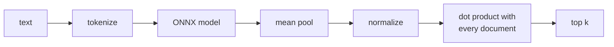

# in-jvm-embeddings

Run a machine-learning embedding model **inside your Java app** with ONNX Runtime, and use it for semantic
search in Spring Boot. No Python, no sidecar, no external API.

The model is [`sentence-transformers/all-MiniLM-L6-v2`](https://huggingface.co/sentence-transformers/all-MiniLM-L6-v2).
It turns any text into 384 numbers (a vector). Texts with similar meaning get similar vectors, so "someone who
builds data pipelines" finds a Data Engineer posting even though they share no words.

## The idea in four steps

`MiniLmEmbedder.embed()` is the whole idea:

```java
long[] tokenIds = tokenizer.encode(text);          // 1. text -> token ids (vocab.txt)
float[][] tokenVectors = runModel(tokenIds);       // 2. ONNX model: one vector per token
float[] sentenceVector = meanPool(tokenVectors);   // 3. average them into one vector
return normalize(sentenceVector);                  // 4. length 1, so dot product = similarity
```



## What's in `app/` (the part you copy)

| File | What it does |
|---|---|
| `WordPieceTokenizer` | Lowercase, remove accents, split into words, then into vocabulary pieces |
| `MiniLmEmbedder` | Loads `model.onnx` and runs the four steps above |
| `SemanticSearchService` | Embeds documents from a JSON file, scores a query against all of them |
| `SearchController` | `GET /search?q=...&k=5` returns `[{id, title, score}]` |
| `SearchApplication` | Spring Boot main |
| `models/all-MiniLM-L6-v2/` | `model.onnx` + `vocab.txt` (not committed, see below) |
| `data/jobs.json` | Sample documents (job postings) |

The code has nothing job-specific. Any JSON array of `{"id", "title", ...text fields}` works.

## 1. Get the model (once, ~90 MB)

From the repo root:

```bash
mkdir -p app/models/all-MiniLM-L6-v2
BASE=https://huggingface.co/sentence-transformers/all-MiniLM-L6-v2/resolve/1110a243fdf4706b3f48f1d95db1a4f5529b4d41
curl -L -o app/models/all-MiniLM-L6-v2/model.onnx $BASE/onnx/model.onnx
curl -L -o app/models/all-MiniLM-L6-v2/vocab.txt  $BASE/vocab.txt
```

If the files are missing, startup fails with a message that gives these two links.

## 2. Run

You need JDK 21+ and Maven 3.9+. Run these from the repo root:

```bash
mvn -pl app spring-boot:run                                  # open http://localhost:8080
curl "http://localhost:8080/search?q=kafka%20engineer&k=5"
DATA_PATH=/path/my_docs.json mvn -pl app spring-boot:run     # your own documents
DATA_TEXT_FIELDS=requirements mvn -pl app spring-boot:run    # embed only some fields
mvn -pl app verify                                           # tests
```

The app runs with `app/` as its working directory, so relative paths such as `./data/jobs.json` are resolved
against `app/`. Use an absolute path for your own files.

Settings live in `app/src/main/resources/application.properties`: `model.dir`, `model.max-length`, `data.path`,
`data.text-fields` and `server.port`. Each one can also be set as an environment variable, such as `MODEL_DIR`
or `DATA_PATH`.

## 3. Use it in your own app

1. Add `com.microsoft.onnxruntime:onnxruntime:1.31.0` to your pom.
2. Copy `WordPieceTokenizer` and `MiniLmEmbedder`. Also copy `SemanticSearchService` if you want the in-memory
   search.
3. Put the model files somewhere and set `model.dir`.

```java
float[] vector = embedder.embed("any text");                  // 384 numbers, length 1
searchService.index(new Document("42", "Title", "text..."));  // add a document from code
List<Hit> hits = searchService.search("what the user typed", 5);
```

## Tests (`app/src/test`)

- `EmbeddingParityTest`: for 16 sample texts, the Java token ids must exactly match Python sentence-transformers,
  and the vectors must match with cosine ≥ 0.9999. The Python output is stored in
  `src/test/resources/fixtures.json`. It was generated once, and the library versions used are recorded inside
  the file.
- `SemanticSearchTest`: starts the app and checks that "someone who builds data pipelines" returns a Data
  Engineer posting in the top 5.

## Benchmarks (`bench/`, optional)

These are only for measuring the app and aren't needed to use it. Run them from the repo root, plugged in to AC
power:

```bash
mvn -pl bench -am package && java -jar bench/target/benchmarks.jar     # JMH latency, console output
java -cp bench/target/benchmarks.jar com.example.search.bench.Report   # writes bench/results/*.md
```

`Report` measures cold start, memory, precision@5 on `bench/data/queries.json` (full posting vs requirements
only), and runs the JMH benchmarks.

## Results

Every number below is copied from [`bench/results/results.md`](bench/results/results.md) and
[`bench/results/eval.md`](bench/results/eval.md). They were measured on 2026-10-24 on a laptop on AC power:
Intel i7-8850H (6 cores / 12 threads), 32 GB RAM, Windows 11, JDK 21, ONNX Runtime 1.31.0. Your numbers will
differ on other hardware.

| What | Result |
|---|---|
| Startup: JVM + model load + first embedding | 878 ms (model load 572 ms) |
| Embed one query | 2.9 ms p50, 4.0 ms p99 |
| Embed the longest posting | 16.0 ms p50, 21.2 ms p99 |
| Index the 330 sample postings | 4.3 s (76 docs/sec, one at a time) |
| Search top-5 over 500 / 10k / 100k documents | 0.22 / 6.0 / 65 ms p50 |
| Memory after indexing | 8 MiB heap, 201 MiB RSS (the model lives outside the Java heap) |
| precision@5, full posting | 0.551 |
| precision@5, requirements-only | 0.820 (best possible: 0.927) |

The search times show where the simple brute-force approach stops being fine: 6 ms at 10k documents, 65 ms at 100k.

Embedding only the requirements beats the full posting here, but read that with care. The sample postings are
synthetic, and their descriptions are mostly boilerplate (company, city, perks) that has nothing to do with the
role. Averaging the token vectors mixes that noise into every posting vector. Real postings have boilerplate too,
in different amounts, so measure on your own data with `data.text-fields`.

## Limitations

- **Simple tokenizer.** It's built for ordinary text in Latin and Cyrillic scripts. Chinese/Japanese text,
  invisible control characters and similar edge cases aren't handled the way the Python tokenizer handles them.
- **One text at a time, CPU only.** There's no batching or GPU.
- **Brute-force search.** Every query is compared with every document. That's fine for a few thousand documents.
  Beyond that, use pgvector or a vector database.
- **English model, 256-token limit.** Longer text is cut off at the end.

## Licenses

- Code: Apache 2.0, see [LICENSE](LICENSE).
- Model: `all-MiniLM-L6-v2` is Apache 2.0 (Hugging Face). It is not included in this repo.
- Data: `app/data/jobs.json` and `bench/data/queries.json` are synthetic, with fictional companies, and were made
  for this repo.
